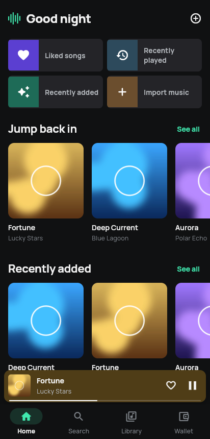
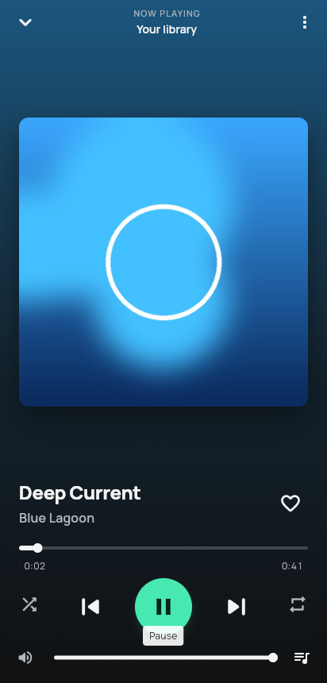
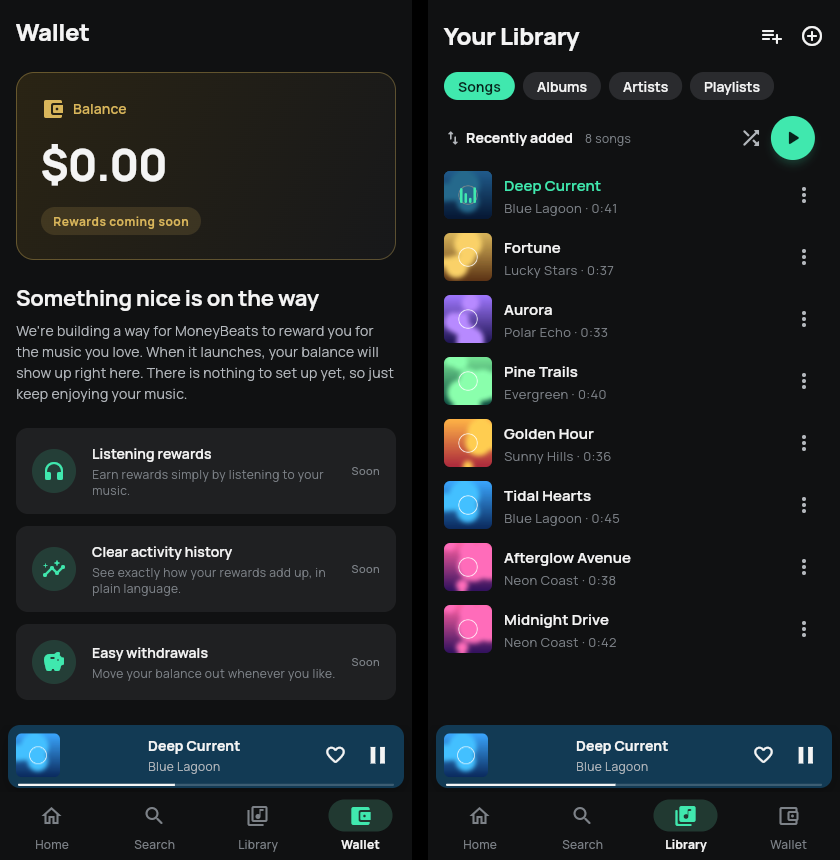
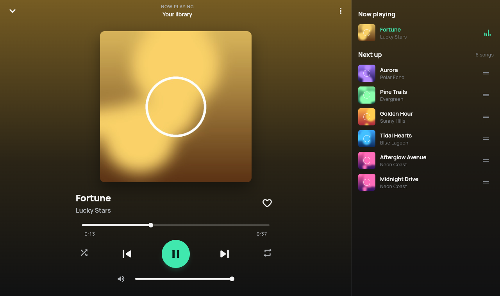

# MoneyBeats

A premium offline music player for Android, iOS and Windows, built with Flutter.
MoneyBeats will one day reward you for the music you listen to. **Phase 1** is the
foundation: a fast, beautiful player for your own MP3s, with no internet,
accounts or external services needed.

| Phone: Home | Phone: Now Playing | Phone: Wallet and Library |
| --- | --- | --- |
|  |  |  |



*Screenshots are from the real app running on the Linux desktop build with
imported demo MP3s.*

---

## What Phase 1 includes

**Home**
- Time-of-day greeting, shortcuts to Liked songs, Recently played, Recently added and Import
- "Jump back in" (recently played), Recently added, Your favorites, and playlist shortcuts
- A friendly welcome card with an Import button when the library is empty

**Music library**
- Import several MP3s at once through the native file picker
- Files are copied into private, app-managed storage, so they keep working even if the
  originals are moved or deleted, and survive restarts
- Titles, artists, albums, album artists, track numbers, years, genres, durations and
  embedded cover art (JPEG/PNG) are read from the ID3 tags
- Untagged files still import nicely: `Artist - Title.mp3` file names are understood
- Duplicates are detected by content (SHA-1), even when the file name differs
- Invalid files are rejected with a clear reason, without stopping the rest of the batch
- Songs, Albums, Artists and Playlists views
- Search across titles, artists and albums (case- and accent-insensitive, every word must match)
- Sort by Recently added, Title, Artist, Album or Duration (remembered between launches)
- Playlists: create, rename, delete, add songs, remove songs, drag to reorder
- Liked songs, play counts and "last played" are stored per song

**Audio player**
- Play / pause, next / previous (previous restarts the song after 3 seconds), seek
- Shuffle and repeat (off, all, one)
- A playback queue: play next, add to queue, drag to reorder, swipe to remove, tap to jump
- Volume control with mute (remembered between launches)
- Accurate duration and progress: the decoder's exact length replaces the tag estimate
- One persistent player across the whole app: music keeps playing while you browse
- A persistent mini player (swipe sideways to skip, swipe up to expand) and an
  expandable full-screen Now Playing view (drag down to close)
- Background playback with notification and lock-screen controls on Android and iOS
- Headphones unplugged? Playback pauses. Calls and other audio interruptions are handled
- The last queue, song and position are restored (paused) when you open the app again
- Desktop keyboard shortcuts: media keys, `Ctrl+Space` play/pause, `Ctrl+←/→` previous/next

**Wallet**
- A reserved tab with a $0.00 balance and a coming-soon message
- No real or simulated earnings yet

**Design**
- Dark theme with a mint accent (`#40E8AE`), Manrope typography (bundled, works offline)
- Large artwork, rounded surfaces, artwork-tinted backgrounds, smooth animations
  (Hero artwork, animated play/pause, playing indicators, press feedback)
- Responsive: phone layout with bottom navigation, desktop/tablet layout (840 px and wider)
  with a sidebar and a full-width player bar

---

## Tech stack

| Area | Package | Version |
| --- | --- | --- |
| Framework | Flutter / Dart | 3.50.1 stable / 3.14 |
| UI | `material_ui`, `cupertino_ui` (Material and Cupertino now ship as packages) | 1.11 / 1.1 |
| State | `flutter_riverpod` | 3.5 |
| Playback | `just_audio` | 0.10.6 |
| Background + lock screen | `just_audio_background` (audio_service) | 0.0.1-beta.17 |
| Audio focus / interruptions | `audio_session` | 0.2.4 |
| Desktop playback backend | `just_audio_media_kit` (libmpv) | 2.1 |
| File import | `file_picker` | 13.4 |
| Tags and artwork | `audio_metadata_reader` (pure Dart) | 1.8 |
| Storage | `sqflite` (mobile), `sqflite_common_ffi` (desktop) | 2.4 |

No Spotify or SoundCloud APIs, no network calls, no sign-in.

---

## Setup

### Prerequisites

- Flutter **3.50.1 stable** (`flutter --version`)
- **Android:** Android Studio or the command-line tools, Android SDK Platform 36, JDK 17+
- **iOS:** a Mac with Xcode 16+ and CocoaPods
- **Windows:** Visual Studio 2022 with the "Desktop development with C++" workload
- **Linux (development only):** `sudo apt install libgtk-3-dev libmpv-dev`

### Run it

```bash
cd moneybeats
flutter pub get
flutter devices                 # find your phone, emulator or desktop
flutter run -d <device-id>      # e.g. an Android phone or emulator
```

Then tap **Import music** and pick some MP3s.

### Build

```bash
flutter build apk --release --split-per-abi   # Android APKs (arm64-v8a for most phones)
flutter build appbundle                       # Android App Bundle for Google Play
flutter build ios                             # on a Mac
flutter build windows                         # on Windows
```

### Development helper: seed a library

Importing through the picker on an emulator or desktop can be fiddly, so a debug
flag imports every MP3 in a folder on first launch, through the normal import
pipeline:

```bash
flutter run -d linux --dart-define=MONEYBEATS_SEED_DIR=/path/to/mp3s
```

### Tests

```bash
flutter analyze
flutter test                     # 56 unit and widget tests
```

The unit tests use real MP3 fixtures (`test/fixtures`) with ID3 tags and embedded
artwork, plus an in-memory SQLite database. The widget tests drive the real app
UI with a fake audio engine.

**On-device integration tests** use the real audio engine and real imported files
to check every playback control (play, pause, seek, next, previous, jump,
shuffle, repeat all/one/off, volume, auto-advance, play next, add to queue,
reorder, remove, end of queue and restart), plus a full app flow from the
Library to Now Playing:

```bash
# Desktop (fixtures are read from test/fixtures)
flutter test integration_test -d linux      # or -d windows

# Android: copy the fixtures into the app's own folder first
adb shell mkdir -p /sdcard/Android/data/com.moneybeats.moneybeats/files/fixtures
adb push test/fixtures/. /sdcard/Android/data/com.moneybeats.moneybeats/files/fixtures/
flutter test integration_test -d <android-device-id> \
  --dart-define=MB_FIXTURES=/sdcard/Android/data/com.moneybeats.moneybeats/files/fixtures
```

---

## Architecture

```
lib/
  main.dart                 Start-up: audio stack, storage, database, providers
  app.dart                  MaterialApp and theme
  core/
    theme/                  Colour tokens, spacing, radii, breakpoints, ThemeData
    platform/               PlatformCapabilities: what each platform supports
    utils/                  Formatters
  data/
    models/                 Track, Playlist, Album, Artist, LibraryQuery (search/sort/group)
    database/               AppDatabase: SQLite schema, migrations, change notifications
    repositories/           Tracks, playlists, settings, listening activity
    storage/                MediaStorage: app-managed music and artwork folders
  services/
    audio/                  AudioPlayerService (interface) + JustAudioPlayerService,
                            playback models, shuffle order, listening tracker,
                            session keeper, platform audio bootstrap
    import/                 File picker gateway, metadata extractor, import service
  state/                    Riverpod providers and controllers
  ui/
    shell/                  Responsive app shell (phone and desktop frames)
    screens/                Home, Search, Library, Collection, Now Playing, Wallet
    widgets/                Artwork, track rows, player controls, mini player,
                            desktop player bar, queue, sheets and dialogs
```

### Layers

```
 UI (screens, widgets)
   │  watches
   ▼
 State (Riverpod providers, controllers, AppCoordinator)
   │  calls
   ▼
 Services (AudioPlayerService, MusicImportService, ListeningTracker, SessionKeeper)
   │  use
   ▼
 Data (repositories → AppDatabase / SQLite, MediaStorage → files)
```

- **One audio engine.** `audioPlayerServiceProvider` holds a single
  `JustAudioPlayerService` (one `just_audio` `AudioPlayer`) for the whole app.
  UI code only sees the `AudioPlayerService` interface, so the engine can be
  replaced or faked in tests. State flows out as streams: status, queue, position,
  volume, effects, errors and exact durations.
- **Platform audio.** `AudioBootstrap` sets up `just_audio_background` on Android
  and iOS (notification, lock screen, headset buttons), `just_audio_media_kit` on
  Windows and Linux, and an `audio_session` configured for music.
- **Storage.** Imported files live in the app's private support folder
  (`%LOCALAPPDATA%\MoneyBeats` on Windows). The database stores file names
  *relative* to that folder because iOS moves app containers between installs.
- **Database.** `tracks`, `playlists`, `playlist_tracks` (ordered, with cascading
  deletes), `listening_sessions` and `settings`. Repositories broadcast changes and
  the library and playlist providers reload automatically.
- **Coordinator.** `AppCoordinator` restores the last session once the library
  loads, keeps queued songs in sync with library edits, stores exact durations
  from the decoder, and runs the listening tracker and session keeper.
- **Navigation.** Each tab has its own navigator, so album, artist and playlist
  pages open inside the tab while the mini player and navigation stay visible.
  Now Playing opens above everything with a slide-up route and a Hero artwork
  transition.

### Ready for what's next

- **Studio (pitch, speed, equaliser):** `AudioEffects` is part of the player state,
  and `setSpeed` / `setPitch` already apply to the engine.
  `PlatformCapabilities.supportsPitch` / `supportsEqualizer` gate features per
  platform (Android exposes a hardware `AndroidEqualizer` through just_audio's
  `AudioPipeline`).
- **Listening rewards:** `ListeningTracker` records every continuous stretch of
  *actual* playback (paused, buffering and seeking time are excluded) into
  `listening_sessions`, with a completion flag. Nothing is turned into money yet;
  the Wallet shows $0.00.

---

## Verification status

Done in the development environment for this phase:

- `flutter analyze`: no issues
- `flutter test`: 56 unit and widget tests passing
- On-device integration tests: both passing on the **Linux desktop** build with the
  real audio engine and real imported MP3s
- **Android:** debug and release APKs build successfully (manifest, background
  service and all plugins compile)
- The app was launched on the Linux desktop and exercised by hand: importing,
  playing, auto-advance, Now Playing, queue, Library, Wallet, phone and desktop
  layouts, and session restore after relaunch

Not yet run on hardware, because no phone, emulator, Mac or Windows machine was
available in this environment:

- Android on a real device or emulator (the APK is ready to install)
- iOS build and run (needs macOS and Xcode)
- Windows build and run (needs Windows)

## Platform notes and remaining requirements

**Android**
- `minSdk` 24, `targetSdk` 36. Background playback uses a `mediaPlayback`
  foreground service (`AudioService`) and `MainActivity` extends
  `AudioServiceActivity`.
- Media notifications don't need the notification permission prompt.
- Release builds are currently signed with the debug key (Flutter's default). Add
  a real keystore before publishing to Google Play.
- The application ID is `com.moneybeats.moneybeats`; change it before the first
  store release if you'd like a different one.

**iOS**
- `UIBackgroundModes: audio` is set in `Info.plist`, and the deployment target is
  iOS 15 (file_picker needs 14+).
- On a Mac: `cd ios && pod install`, open `Runner.xcworkspace`, pick your signing
  team, then `flutter run`.
- MP3s are picked through the Files app document picker, so no media-library
  permission is needed.

**Windows**
- Playback uses libmpv via `media_kit_libs_windows_audio`, which downloads libmpv
  during the first build (internet needed for that build only).
- SQLite is bundled automatically by the `sqlite3` package's build hook.
- Windows media overlay controls (SMTC) are not wired up yet; playback continues
  while the window is minimised, and media keys work while it is focused.

**Linux (development target)**
- Needs `libgtk-3-dev` and `libmpv-dev`.
- For fully offline builds, set `MONEYBEATS_OFFLINE_BUILD=1` to skip media_kit's
  mimalloc download.
- On virtual displays with software OpenGL, Impeller can draw gradients with a hard
  edge. Run with `FLUTTER_ENGINE_SWITCHES=1 FLUTTER_ENGINE_SWITCH_1=enable-impeller=false`
  there. Real GPUs are fine.

**Desktop shuffle**
- The desktop backend can't take a custom shuffle order, so on Windows and Linux
  MoneyBeats shuffles by reordering the queue itself (the current song keeps
  playing from the same spot after a brief reload) and restores the original order
  when shuffle is turned off. Android and iOS use the engine's native shuffle.

---

## Roadmap

- **Phase 2, Studio:** pitch shifting, playback speed, bass boost and equaliser presets
  (Original, Nightcore, Slowed + Reverb, Bass Boosted)
- **Phase 3, Rewards:** turn verified listening activity into a real balance, with
  clear rules and withdrawals
