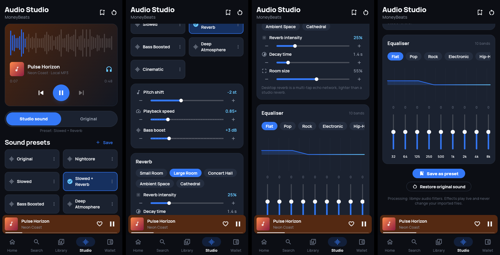
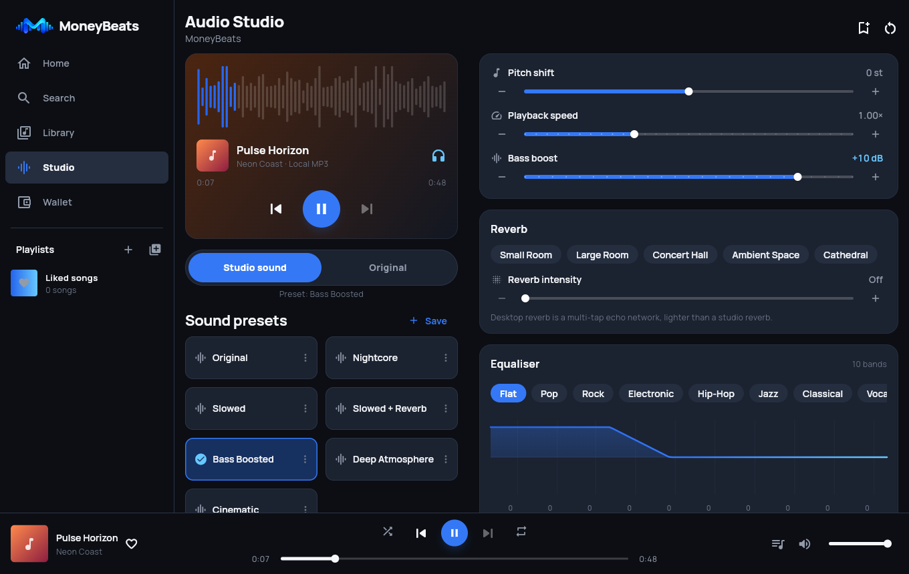

# MoneyBeats

<p align="center"></p>

A premium offline music player for Android, iOS and Windows, built with Flutter.
MoneyBeats will one day reward you for the music you listen to. Right now it's
a fast, beautiful player for your own MP3s, with no internet, accounts or
external services needed.

- **Phase 1** built the foundation: the library, importing, the player, the queue,
  background playback and the Wallet placeholder.
- **Phase 2** adds the **Audio Studio**: live pitch, speed, a 10-band equaliser,
  bass boost, reverb, sound presets and a real waveform of every song.

| Phone: Home | Phone: Now Playing | Phone: Wallet and Library |
| --- | --- | --- |
|  |  |  |

**Audio Studio on a phone:** waveform, compare toggle, presets, pitch, speed,
bass, reverb and the equaliser.






*Screenshots are from the real app running on the Linux desktop build with
imported demo MP3s. The Studio footer names the engine in use, here libmpv's
audio filters.*

---

## What Phase 1 includes

**Home**
- Time-of-day greeting, shortcuts to Liked songs, Recently played, Recently added and Import
- "Jump back in" (recently played), Recently added, Your favorites, and playlist shortcuts
- A friendly welcome card with an Import button when the library is empty

**Music library**
- Import several MP3s at once through the native file picker
- Files are copied into private, app-managed storage, so they keep working even if the
  originals are moved or deleted, and survive restarts
- Titles, artists, albums, album artists, track numbers, years, genres, durations and
  embedded cover art (JPEG/PNG) are read from the ID3 tags
- Untagged files still import nicely: `Artist - Title.mp3` file names are understood
- Duplicates are detected by content (SHA-1), even when the file name differs
- Invalid files are rejected with a clear reason, without stopping the rest of the batch
- Songs, Albums, Artists and Playlists views
- Search across titles, artists and albums (case- and accent-insensitive, every word must match)
- Sort by Recently added, Title, Artist, Album or Duration (remembered between launches)
- Playlists: create, rename, delete, add songs, remove songs, drag to reorder
- Liked songs, play counts and "last played" are stored per song

**Audio player**
- Play / pause, next / previous (previous restarts the song after 3 seconds), seek
- Shuffle and repeat (off, all, one)
- A playback queue: play next, add to queue, drag to reorder, swipe to remove, tap to jump
- Volume control with mute (remembered between launches)
- Accurate duration and progress: the decoder's exact length replaces the tag estimate
- One persistent player across the whole app: music keeps playing while you browse
- A persistent mini player (swipe sideways to skip, swipe up to expand) and an
  expandable full-screen Now Playing view (drag down to close)
- Background playback with notification and lock-screen controls on Android and iOS
- Headphones unplugged? Playback pauses. Calls and other audio interruptions are handled
- The last queue, song and position are restored (paused) when you open the app again
- Desktop keyboard shortcuts: media keys, `Ctrl+Space` play/pause, `Ctrl+←/→` previous/next

**Wallet**
- A reserved tab with a $0.00 balance and a coming-soon message
- No real or simulated earnings, and no banking connections

---

## Phase 2: the Audio Studio

Open it from the **Studio** tab, or with the sliders button on Now Playing.
Everything plays live on the song you're listening to, and your imported files
are never changed.

**Track and waveform**
- Artwork, title, artist, transport controls and progress for the current song
- A waveform drawn from the song's **actual audio**, in the MoneyBeats blue
  gradient. Tap or drag it to seek
- Waveforms are analysed off the UI thread (in a background isolate or natively),
  cached on disk, and fall back to a simple progress bar if a file can't be read.
  While a waveform is being analysed you see a calm flat line, never made-up bars

**Controls**

| Control | Range | Notes |
| --- | --- | --- |
| Pitch | −12 to +12 semitones, 0.1 steps | `pitchFactor = 2^(semitones / 12)`, independent of speed |
| Speed | 0.5× to 2.0×, 0.05 steps | keeps the pitch where it is |
| Equaliser | 10 bands, 32 Hz to 16 kHz, ±12 dB | live frequency-response curve; adapts to the device's own bands on Android |
| EQ presets | Flat, Pop, Rock, Electronic, Hip-Hop, Jazz, Classical, Vocal, Acoustic, Cinematic | editing a band switches to "Custom" |
| Bass boost | 0 to 12 dB | automatic headroom plus a limiter so boosts don't clip |
| Reverb | Small Room, Large Room, Concert Hall, Ambient Space, Cathedral | wet/dry intensity, decay time and room size |

Every slider also has fine − / + buttons, and the values are validated (clamped
and snapped) before they reach the audio engine.

**Compare and restore**
- **Studio sound / Original**: hear the untouched song for a moment without
  losing your settings, then flip back
- **Restore original sound** resets pitch, speed, EQ, bass and reverb in one tap

**Sound presets**

| Built-in preset | Pitch | Speed | Bass | Reverb |
| --- | --- | --- | --- | --- |
| Original | 0 | 1.00× | 0 dB | off |
| Nightcore | +3 st | 1.25× | 0 dB | off |
| Slowed | −2 st | 0.85× | 0 dB | off |
| Slowed + Reverb | −2 st | 0.85× | +3 dB | 25% |
| Bass Boosted | 0 | 1.00× | +10 dB | off |
| Deep Atmosphere | −3 st | 0.90× | +4 dB | 60% |
| Cinematic | 0 | 0.95× | +5 dB | 35% |

Your own presets can be **saved, named, renamed, duplicated (built-ins too),
updated and deleted**. Any preset can also be:
- **Set as default**: used every time MoneyBeats starts
- **Assigned to a song**: it switches on whenever that song plays, and the
  global sound comes back for the next song
- **Applied to all songs**: one sound everywhere, clearing song-specific presets

Presets store an id, a name, every parameter, and created/modified dates in
SQLite. Your current sound is remembered between launches.

**Listening lifecycle (groundwork for rewards)**

The audio engine reports *started, paused, resumed, stopped, track changed,
speed changed, seeked, track completed* and *queue completed* events. The
listening tracker stores **real elapsed time** and **media time** separately,
so a song played at 1.5× for 4 minutes counts as 4 minutes listened and 6 minutes
of the song. Queue reshuffles and removals don't count as a song finishing, and
a repeat-one loop counts once. Nothing is turned into money; the Wallet still
shows $0.00.

### What each platform supports

The Studio only shows a control as working when the engine underneath can
actually do it. Anything else shows a short note saying it isn't available on
that device.

| Feature | Android | Windows / Linux | iOS |
| --- | --- | --- | --- |
| Engine | ExoPlayer + `android.media.audiofx` | libmpv audio filters (FFmpeg) | AVPlayer |
| Speed | ✅ | ✅ | ✅ |
| Pitch (independent of speed) | ✅ ExoPlayer | ✅ resample + time-stretch | ➖ not yet |
| Equaliser | ✅ device bands (often 5), mapped from the 10-band curve | ✅ all 10 bands | ➖ not yet |
| Bass boost | ✅ native BassBoost, or a low shelf on the EQ | ✅ shelf filter | ➖ not yet |
| Reverb | ⚠️ EnvironmentalReverb, if the device has it (see below) | ✅ multi-tap echo network | ➖ not yet |
| Headroom / limiter | ✅ volume headroom | ✅ headroom + `alimiter` | n/a |
| Waveform | PCM peaks (`just_waveform`) | MP3 frame loudness, analysed in Dart | PCM peaks (`just_waveform`) |

- ✅ = implemented and enabled when the device reports support.
- ⚠️ = implemented, waiting for a real phone to confirm it.
- ➖ = not on this platform yet, and the Studio says so.

Android reports its capabilities at runtime: the equaliser bands appear once a
song loads, and BassBoost / EnvironmentalReverb are checked through a small
Kotlin bridge (`AudioEffectsBridge.kt`) on the player's audio session.

---

## Tech stack

| Area | Package | Version |
| --- | --- | --- |
| Framework | Flutter / Dart | 3.50.1 stable / 3.14 |
| UI | `material_ui`, `cupertino_ui` (Material and Cupertino now ship as packages) | 1.11 / 1.1 |
| State | `flutter_riverpod` | 3.5 |
| Playback | `just_audio` | 0.10.6 |
| Background + lock screen | `just_audio_background` (audio_service) | 0.0.1-beta.17 |
| Audio focus / interruptions | `audio_session` | 0.2.4 |
| Desktop playback backend | `just_audio_media_kit` (libmpv), vendored in `packages/` | 2.1 |
| Android equaliser | `AndroidEqualizer` (just_audio's `AudioPipeline`) | – |
| Android bass boost / reverb | `android.media.audiofx` via a MethodChannel | – |
| Waveforms (mobile) | `just_waveform` | 0.0.7 |
| File import | `file_picker` | 13.4 |
| Tags and artwork | `audio_metadata_reader` (pure Dart) | 1.8 |
| Storage | `sqflite` (mobile), `sqflite_common_ffi` (desktop) | 2.4 |

No Spotify or SoundCloud APIs, no network calls, no sign-in.

**About the vendored desktop backend:** the audio engine is still the same
`just_audio` player from Phase 1, nothing was replaced. On Windows and Linux,
`just_audio_media_kit` is copied into `packages/just_audio_media_kit` (it's
public domain, under the Unlicense) with one small addition, `setAudioFilters`,
so MoneyBeats can own libmpv's `af` filter chain. The package's built-in pitch
option also writes to `af`, so it's switched off (`JustAudioMediaKit.pitch = false`)
and the Studio's chain handles pitch itself. Every Phase 1 playback test still
passes on the real engine.

---

## Setup

### Prerequisites

- Flutter **3.50.1 stable** (`flutter --version`)
- **Android:** Android Studio or the command-line tools, Android SDK Platform 36, JDK 17+
- **iOS:** a Mac with Xcode 16+ and CocoaPods
- **Windows:** Visual Studio 2022 with the "Desktop development with C++" workload
- **Linux (development only):** `sudo apt install libgtk-3-dev libmpv-dev`

### Run it

```bash
cd moneybeats
flutter pub get
flutter devices                 # find your phone, emulator or desktop
flutter run -d <device-id>      # e.g. an Android phone or emulator
```

Then tap **Import music**, pick some MP3s, play one and open the **Studio** tab.

### Build

```bash
flutter build apk --release --split-per-abi   # Android APKs (arm64-v8a for most phones)
flutter build appbundle                       # Android App Bundle for Google Play
flutter build ios                             # on a Mac
flutter build windows                         # on Windows
```

### Development helper: seed a library

Importing through the picker on an emulator or desktop can be fiddly, so a debug
flag imports every MP3 in a folder on first launch, through the normal import
pipeline:

```bash
flutter run -d linux --dart-define=MONEYBEATS_SEED_DIR=/path/to/mp3s
```

### Tests

```bash
flutter analyze
flutter test                     # 103 unit and widget tests
```

The unit tests use real MP3 fixtures (`test/fixtures`) with ID3 tags and embedded
artwork, plus an in-memory SQLite database. The widget tests drive the real app
UI with a fake audio engine. The Phase 2 tests cover:

- **Maths and validation:** semitone conversion, clamping, step snapping and NaN guards.
- **Presets:** JSON serialisation, every built-in preset's values, and the ten EQ presets.
- **Effect maths:** EQ interpolation, mapping to 5-band devices, the bass shelf,
  headroom, Android BassBoost and reverb parameters, and the desktop filter chain.
- **Database:** the preset repository (create, rename, duplicate, update, delete,
  default and per-song assignments), and the **v1 → v2 database upgrade keeping an
  existing Phase 1 library**.
- **AudioEffectsService:**
  - settings reach the engine, and rapid slider moves coalesce
  - compare and restore original
  - effects a device can't do are never sent
  - live capability changes
  - settings survive a restart, and the default profile is used at startup
  - song presets switch in and out, and apply-to-all clears them
- **Android capability detection** over a mocked MethodChannel, including honest notes
  when a device has no effects.
- **Waveforms:** MP3 frame loudness follows the real audio (bursts vs a steady tone),
  percentile normalisation, and extracting once, caching and reloading.
- **Listening:** media time vs real time.
- **Studio screen:** presets, compare, restore, the fine buttons, and the notes for
  unsupported effects.

**On-device integration tests** run the real audio engine with real imported files.

`integration_test/playback_test.dart`:
- Every playback control: play, pause, seek, next, previous, jump, shuffle, repeat
  all/one/off, volume, auto-advance, play next, add to queue, reorder, remove, and
  end of queue followed by a restart.
- Every lifecycle event.
- A full app flow from the Library to Now Playing.

`integration_test/studio_audio_test.dart` records what the app **actually plays**
and measures it with a Goertzel filter (Linux, through a PulseAudio null sink and
`parec`).

```bash
# Desktop (fixtures are read from test/fixtures)
flutter test integration_test -d linux      # or -d windows (playback_test only)

# Android: copy the fixtures into the app's own folder first
adb shell mkdir -p /sdcard/Android/data/com.moneybeats.moneybeats/files/fixtures
adb push test/fixtures/. /sdcard/Android/data/com.moneybeats.moneybeats/files/fixtures/
flutter test integration_test/playback_test.dart -d <android-device-id> \
  --dart-define=MB_FIXTURES=/sdcard/Android/data/com.moneybeats.moneybeats/files/fixtures
```

For the Studio audio test on Linux, start PulseAudio with a null sink first:

```bash
pulseaudio -D --exit-idle-time=-1
pactl load-module module-null-sink sink_name=moneybeats_null
pactl set-default-sink moneybeats_null
flutter test integration_test/studio_audio_test.dart -d linux
```

---

## Architecture

```
moneybeats/
├── android/ ios/ windows/       Platform projects (linux/ is a development target)
├── assets/                      Fonts and the in-app logo
├── lib/
│   ├── main.dart                Start-up (audio, effects, storage, database, providers)
│   ├── core/
│   │   ├── theme/               Colour tokens and ThemeData
│   │   ├── constants/           App constants, spacing, radii and breakpoints
│   │   ├── utilities/           Formatters, PlatformCapabilities
│   │   ├── navigation.dart      Tabs, per-tab navigators, navigation helpers
│   │   └── providers.dart       Root providers: database, storage, audio, effects, repositories
│   ├── models/                  Track, Playlist, Album, Artist, playback state and lifecycle,
│   │                            LibraryQuery, audio_effects.dart (settings, presets, capabilities)
│   ├── repositories/            SQLite (AppDatabase) and the track, playlist, settings,
│   │                            listening and audio preset repositories
│   ├── services/
│   │   ├── audio_service.dart            The single audio engine (interface + just_audio implementation)
│   │   ├── audio_effects_service.dart    The Studio's source of truth: settings, presets, A/B, engine sync
│   │   ├── platform_audio_processor.dart Processor interface, speed-only fallback, effect maths
│   │   ├── android_audio_processor.dart  Android EQ, BassBoost and EnvironmentalReverb
│   │   ├── mpv_audio_processor.dart      Desktop libmpv filter chain
│   │   ├── waveform_service.dart         Real waveforms (PCM or MP3 frame loudness), cached
│   │   ├── import_service.dart           File picker, tag/artwork extraction, importing
│   │   ├── storage_service.dart          App-managed music, artwork, waveform and database folders
│   │   ├── listening_tracker.dart        Records real listening time and media time
│   │   └── playback_session_keeper.dart  Saves and restores the queue and settings
│   ├── features/
│   │   ├── home/                Home screen
│   │   ├── search/              Search screen and search state
│   │   ├── library/             Library, album/artist/playlist pages, playlists, importing
│   │   ├── player/              Now Playing, mini player, desktop player bar, controls,
│   │   │                        queue, playback state and coordinator
│   │   ├── studio/              Audio Studio screen, controls, presets and providers
│   │   └── wallet/              Wallet screen
│   └── widgets/                 Shared widgets: app shell, artwork, track rows, waveform, logo
├── packages/just_audio_media_kit/  Vendored desktop backend (adds setAudioFilters)
├── test/                        Unit and widget tests (+ MP3 fixtures)
├── integration_test/            On-device tests with the real audio engine
├── branding/                    Logo source and icon generator
├── pubspec.yaml
└── README.md
```

### Layers

```
 Features and widgets (screens, feature state)
   │  watch / call
   ▼
 Services (AudioPlayerService, AudioEffectsService, WaveformService,
           MusicImportService, ListeningTracker, SessionKeeper)
   │  use                                   │  drives
   ▼                                        ▼
 Repositories (AppDatabase / SQLite)    PlatformAudioProcessor
 StorageService (files) · Models        (Android / libmpv / speed-only)
```

- **One audio engine.** `audioPlayerServiceProvider` holds a single
  `JustAudioPlayerService` (one `just_audio` `AudioPlayer`) for the whole app.
  UI code only sees the `AudioPlayerService` interface, so the engine can be
  replaced or faked in tests. State flows out as streams: status, queue, position,
  volume, lifecycle events, errors and exact durations.
- **One source of truth for effects.** `AudioEffectsService` owns the Studio's
  state. The UI reads it and calls its methods, and only the service talks to the
  engine:
  - speed and pitch go to the player
  - EQ, bass and reverb go to the platform's `PlatformAudioProcessor`
  - headroom goes to the player's effects gain, kept separate from your volume
  - rapid slider moves coalesce into the latest value, so nothing queues up
- **Non-destructive.** Effects are applied while the audio plays. Imported files
  are never re-encoded or modified.
- **Capability detection.** Each processor publishes `AudioEffectsCapabilities`
  (and updates them live, e.g. when Android's equaliser bands become known). The
  service strips anything unsupported before it reaches the engine, and the
  Studio shows a note instead of a control.
- **Platform audio.** `AudioBootstrap` sets up `just_audio_background` on Android
  and iOS (notification, lock screen, headset buttons), `just_audio_media_kit` on
  Windows and Linux, and an `audio_session` configured for music. Android's
  `AndroidEqualizer` sits in the player's `AudioPipeline`.
- **Storage.** Imported files live in the app's private support folder
  (`%LOCALAPPDATA%\MoneyBeats` on Windows). The database stores file names
  *relative* to that folder because iOS moves app containers between installs.
  Waveforms are cached as small JSON files in `waveforms/`.
- **Database (schema v2).**
  - Tables: `tracks`, `playlists`, `playlist_tracks` (ordered, with cascading
    deletes), `listening_sessions` (now with `media_ms`), `settings`,
    `audio_presets` and `track_audio_presets`.
  - Upgrading from Phase 1 only adds things, so existing libraries are kept.
  - Repositories broadcast changes, and providers reload automatically.
- **Coordinator.** `PlaybackCoordinator` (features/player) restores the last session once the library
  loads, keeps queued songs in sync with library edits, stores exact durations
  from the decoder, and runs the listening tracker and session keeper.
- **Navigation.** Each tab has its own navigator, so album, artist and playlist
  pages open inside the tab while the mini player and navigation stay visible.
  Now Playing opens above everything with a slide-up route and a Hero artwork
  transition. The Studio is its own tab, and Now Playing's sliders button opens it.

### How each engine applies effects

- **Android:**
  - Pitch and speed use ExoPlayer (`setPitch` / `setSpeed`).
  - The 10-band curve is sampled at the device's own equaliser bands and clamped
    to its range.
  - Bass uses the native BassBoost when the device has one (strength 0 to 1000);
    otherwise it becomes a low shelf on the equaliser.
  - Reverb uses EnvironmentalReverb on the player's audio session.
- **Windows / Linux:** a single FFmpeg filter graph in libmpv's `af` property:
  - pitch: `aresample`, `asetrate`, `aresample`, `atempo`
  - headroom: `volume`
  - EQ: ten `equalizer` stages
  - bass: a `bass` shelf at 160 Hz
  - reverb: two power-normalised `aecho` stages
  - limiter: `alimiter`

  When nothing is changed, the chain is empty.
- **iOS:** AVPlayer handles speed (with pitch kept). Pitch, EQ, bass and reverb
  need an AVAudioEngine-based player, see the roadmap.

---

## Verification status

**Checked in the development environment:**

- `flutter analyze`: no issues
- `flutter test`: **103** unit and widget tests passing
- `integration_test/playback_test.dart`: passing on the **Linux desktop** with the real
  engine and real imported MP3s, five runs in a row. It covers every Phase 1
  control and every lifecycle event.
- `integration_test/studio_audio_test.dart`: passing on Linux, measured from the real
  audio output:

| Check | Measured | Expected |
| --- | --- | --- |
| Pitch +2 st on a 440 Hz tone | 494.0 Hz | 493.9 Hz |
| Pitch −12 st | 220.0 Hz | 220 Hz |
| Speed 1.5× keeps the pitch | 440.0 Hz | 440 Hz |
| Speed 1.5×, beep spacing | 670 ms | 667 ms |
| Slowed preset (−2 st, 0.85×) | 392.0 Hz | 392 Hz |
| EQ: treble up, bass down | +24.0 dB treble vs bass | strong tilt |
| Bass boost +12 dB | +10.8 dB bass vs treble | ≈ +12 dB shelf |
| Reverb fills the gaps between beeps | −17 dB wet vs −111 dB dry | audible tail |
| Compare original with pitch +5 kept | 440.0 Hz | 440 Hz |
| Big EQ boost, peak level | under full scale (test requires < 99%) | no clipping |

- **Android:** release APKs build with the Kotlin effects bridge and the
  `MODIFY_AUDIO_SETTINGS` permission.
- **Linux:** the release build runs, and the app was exercised by hand (Studio,
  presets, compare, waveform seeking, phone and desktop layouts).

**Needs testing on real hardware** (no phone, emulator, Mac or Windows machine
was available in this environment):

- **Android at runtime:**
  - pitch, the equaliser's device bands, BassBoost and EnvironmentalReverb on a real phone
  - the PCM waveform
  - the Studio's capability notes on different devices
- **Android reverb in particular:** EnvironmentalReverb is created on the player's
  audio session. Some phones only offer it as an *auxiliary* effect, where it may
  stay quiet. If that happens, attach it through ExoPlayer's `setAuxEffectInfo`
  (listed under next steps).
- **Windows:** the same libmpv filter chain as Linux, so it should behave the same,
  but it hasn't been run yet.
- **iOS:** build and run, speed control, and the "not available yet" notes.

## Platform notes and remaining requirements

**Android**
- `res/raw/keep.xml` stops release builds from stripping resources that are looked
  up by name at runtime (the notification icon and audio_service's notification
  buttons). Keep it if you add more by-name resources.
- `minSdk` 24, `targetSdk` 36. Background playback uses a `mediaPlayback`
  foreground service (`AudioService`) and `MainActivity` extends
  `AudioServiceActivity`. It also registers the `moneybeats/audio_effects` channel.
- `MODIFY_AUDIO_SETTINGS` is declared for the audio effects (no prompt needed).
- Audio effects vary by phone maker. The Studio adapts to the bands and effects
  each phone reports.
- Media notifications don't need the notification permission prompt.
- Release builds are currently signed with the debug key (Flutter's default). Add
  a real keystore before publishing to Google Play.
- The application ID is `com.moneybeats.moneybeats`; change it before the first
  store release if you'd like a different one.

**iOS**
- `UIBackgroundModes: audio` is set in `Info.plist`, and the deployment target is
  iOS 15 (file_picker needs 14+).
- On a Mac: `cd ios && pod install`, open `Runner.xcworkspace`, pick your signing
  team, then `flutter run`.
- MP3s are picked through the Files app document picker, so no media-library
  permission is needed.
- The Studio offers speed today; pitch, EQ, bass and reverb show a friendly
  "not available on iOS yet" note.

**Windows**
- Playback uses libmpv via `media_kit_libs_windows_audio`, which downloads libmpv
  during the first build (internet needed for that build only). Its FFmpeg
  includes the filters the Studio uses. If a build ever doesn't, the Studio
  notices and switches those controls off.
- SQLite is bundled automatically by the `sqlite3` package's build hook.
- Windows media overlay controls (SMTC) are not wired up yet; playback continues
  while the window is minimised, and media keys work while it is focused.

**Linux (development target)**
- Needs `libgtk-3-dev` and `libmpv-dev`.
- For fully offline builds, set `MONEYBEATS_OFFLINE_BUILD=1` to skip media_kit's
  mimalloc download.
- On virtual displays with software OpenGL, Impeller can draw gradients with a hard
  edge. Run with `FLUTTER_ENGINE_SWITCHES=1 FLUTTER_ENGINE_SWITCH_1=enable-impeller=false`
  there (debug and profile builds). Real GPUs are fine.

**Desktop shuffle**
- The desktop backend can't take a custom shuffle order, so on Windows and Linux
  MoneyBeats shuffles by reordering the queue itself (the current song keeps
  playing from the same spot after a brief reload) and restores the original order
  when shuffle is turned off. Android and iOS use the engine's native shuffle.

---

## Branding

The logo source lives in `branding/moneybeats_logo_source.webp`. Every icon and
splash image is generated from it:

```bash
python3 branding/generate_icons.py    # needs Pillow: pip install pillow
```

| Output | Where |
| --- | --- |
| In-app logo | `assets/brand/moneybeats_logo.png` (`AppLogoMark` widget) |
| Android launcher icon | adaptive icon (dark background + logo), legacy PNGs, and a monochrome layer for Android 13+ themed icons |
| Android notification icon | `drawable-*/ic_stat_moneybeats.png` (white silhouette) |
| Android splash | logo on `#0C0E14`, plus the Android 12+ system splash colour |
| iOS app icon and launch screen | `AppIcon.appiconset`, `LaunchImage.imageset`, dark `LaunchScreen.storyboard` |
| Windows icon | `windows/runner/resources/app_icon.ico` |

Swap in a new source file and re-run the script to rebrand everything at once.

**Colours (Phase 2 blue design system)**

| Token (`AppColors`) | Value | Used for |
| --- | --- | --- |
| `primary` | `#3478F6` | buttons, selected states, sliders |
| `electric` | `#2563EB` | the deep end of the brand gradient |
| `ice` | `#67C8FF` | highlights and the bright end of the gradient |
| `background` | `#0C0E14` | app background, icons and splash |
| `backgroundSecondary` | `#121722` | panels and gradients |
| `surfaceRaised` | `#1B2230` | cards, preset tiles, chips |
| `textPrimary` | `#F5F7FA` | main text |
| `textSecondary` | `#929BAA` | secondary text |

---

## Roadmap

- **Next for the Studio:**
  - Try the APK on a few Android phones and confirm pitch, the equaliser, bass and
    reverb on each.
  - If reverb is quiet on a phone, attach EnvironmentalReverb as an auxiliary effect
    through ExoPlayer.
  - Run the desktop build on Windows.
  - Bring pitch, EQ, bass and reverb to iOS with an AVAudioEngine-based player
    (for example `flutter_soloud`, or a small native AVAudioUnitTimePitch / EQ / reverb chain).
- **Phase 3, Rewards:** turn verified listening activity (real and media time are
  already recorded) into a real balance, with clear rules and withdrawals
